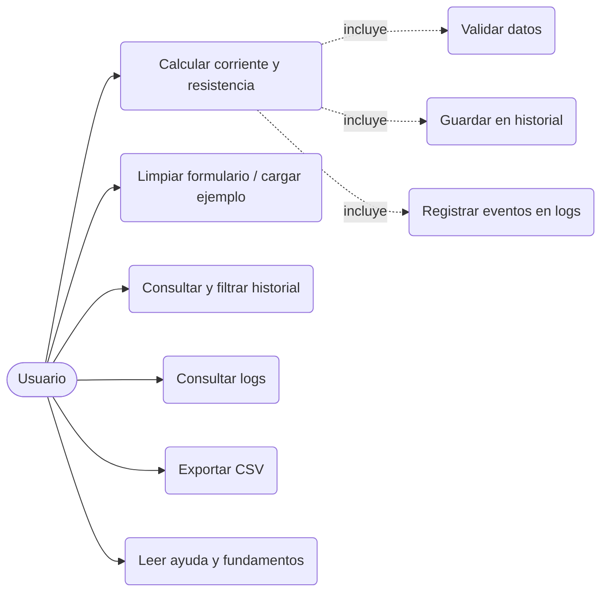
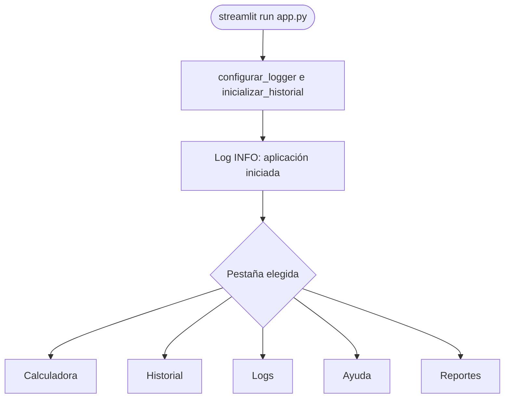
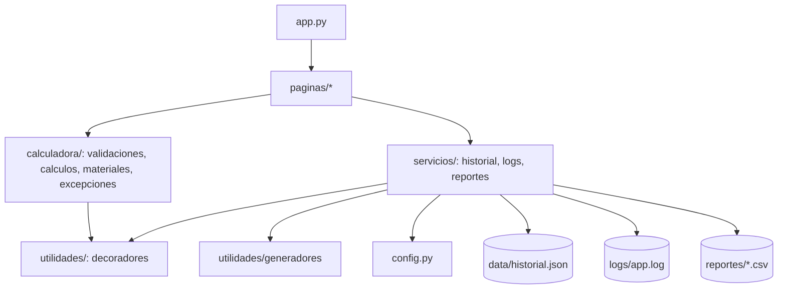
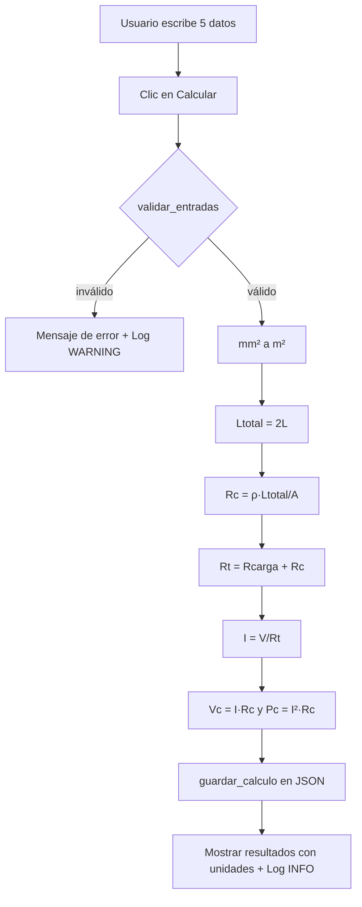
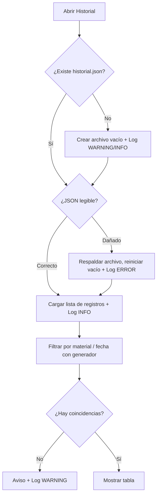
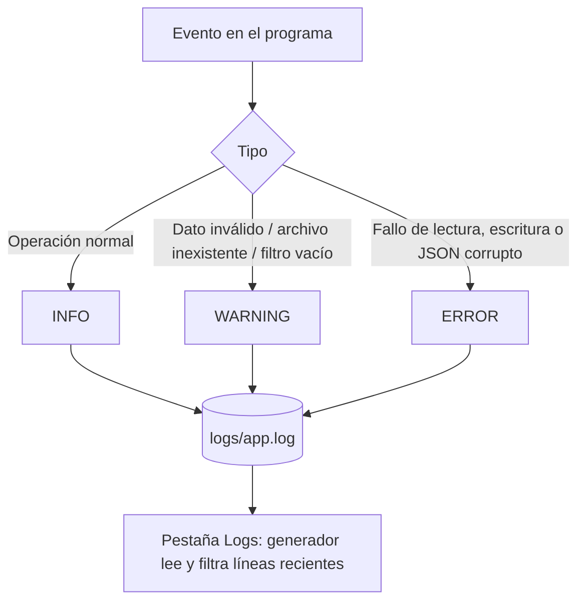
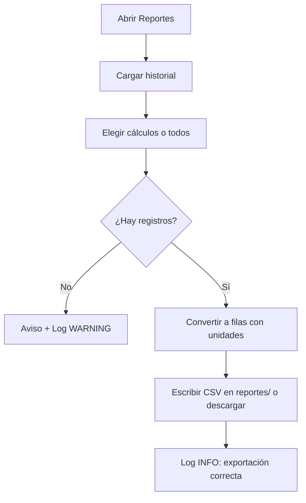

# Diagramas para el informe (formato Mermaid)

Cómo usarlos: abrir https://mermaid.live → pegar el código de un diagrama → **Actions → PNG** → insertar en el
informe con su título y una explicación breve. Todos corresponden al código real del proyecto.

## 1. Casos de uso general

## 2. Flujo general de la aplicación

## 3. Arquitectura / módulos

## 4. Flujo de la calculadora

## 5. Flujo del historial

## 6. Flujo de Logs

## 7. Flujo de reportes

